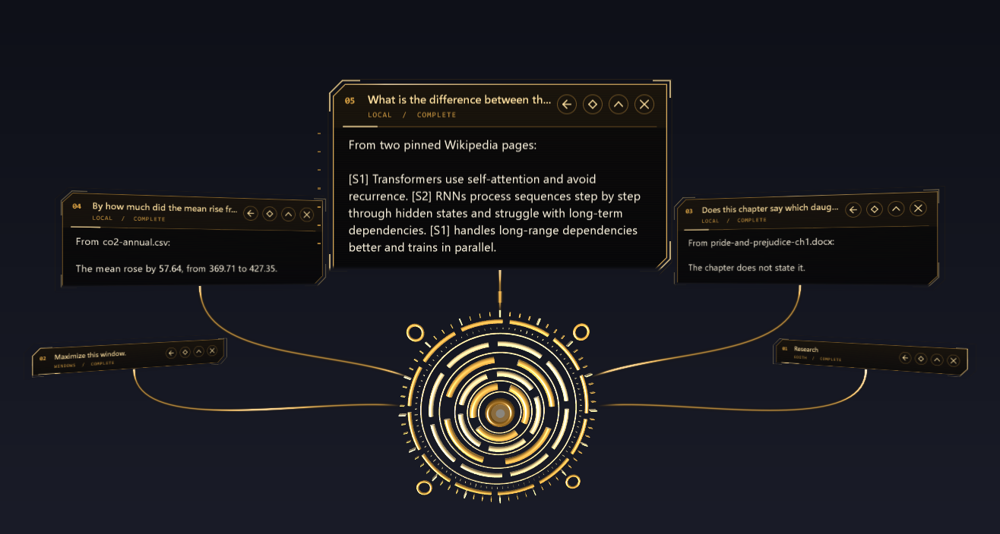

# E D I T H

### Your work stays on your desktop. Your assistant should know which work you mean.

[Request a demonstration](mailto:skilaru@arizona.edu?subject=EDITH%20demonstration) · [Private implementation](https://github.com/hemu77/edith-windows-assistant)

Windows-native interaction · Local-first inference · Source-aware answers · Governed tools

## The idea

EDITH explores a practical question: can a small local model become a useful desktop assistant when its surrounding software supplies the right evidence, clear permissions and reliable tools?

Rather than treating the desktop as one giant prompt, EDITH tracks the owner's selected source, distinguishes captured facts from missing information, and separates answering from acting. Voice and typed requests share a runtime. A transparent golden HUD keeps answers near the work.

The goal is accessible, private assistance with reading, comparing, remembering and bounded desktop tasks. It is a working prototype—not AGI, a universal computer operator, or a guarantee of error-free answers.

## The golden HUD

Existing project visual of the native golden reactor and layered-answer design. This is not a new recording of the October 23 tests, proof of speech accuracy, or a promise that every displayed interaction works on every device. The private repository contains implementation details and the verification record.

## Why this project is interesting

| Design choice | Why it matters |
|---|---|
| A source desk, not a pile of screenshots | Captures retain source identity and versions. Ambiguous or sensitive sources need deliberate handling. |
| Local reasoning with typed host controls | A plausible model instruction is not execution permission. Tools have contracts, approvals and recorded results. |
| Evidence-aware completion | A displayed answer, accepted request and completed action are different states. Tests check terminal evidence, not reassuring words. |
| Personal and Research boundaries | Explicitly saved facts and temporary source history have different lifetimes. Missing memory must not become invented recollection. |
| Native layered interaction | The golden OpenGL reactor and message panes coexist with ordinary Windows applications; typed input complements voice. |

These are integrated engineering priorities, not claims that no other project has similar features.

## Current implementation scope

- Hotkey activation, native HUD, typed interaction and a local voice pipeline.
- Windows readings and registered controls, with consequential actions gated.
- Text, Word, PDF and CSV analysis; bounded browser/window capture when accessible.
- Source labels, extraction coverage, pinned-source comparison and temporary session recall.
- A governed MCP host with bounded transport, tool-definition checks, one-use approval decisions and action receipts.
- Explicit local Personal memory with searchable owner statements and exact-ID deletion. No automatic learning of private documents into model weights.
- Original local Qwen inference retained. Codex routing is disabled in the shared local-only installation.

Offline use requires installing model and speech assets first. Optional network tools have their own disclosure boundaries. EDITH does not read every tab, understand every application, or certify a whole book's factual summary.

## Recent engineering work

The October 23 recovery addresses bugs that can masquerade as weak model intelligence: explicit file questions that never capture the file; cleared Research sessions falling back to invented recall; HUD completion before the next turn can be accepted; and approvals becoming stale while tools wait.

The private handoff separates reproduced failures, regression tests, live typed checks and pending physical tests. Synthetic fixtures and real local documents are used without publishing private desktop logs. Numerical benchmark and readiness claims belong to the pinned evidence record—not this showcase.

## Technology

| Layer | Stack and role |
|---|---|
| Desktop runtime | Python, Win32/ctypes, Windows UI Automation and local IPC |
| Native presentation | OpenGL/moderngl, software fallback, transparent layered windows and interactive panes |
| Control center | React, TypeScript and Vite; separate from the native golden HUD |
| Local inference | Quantized GGUF through llama.cpp; original Qwen3-4B deployment retained |
| Speech | Local capture/VAD, Faster Whisper recognition, owner verification and Windows speech playback |
| Documents | Local parsers, structured table calculations and bounded source extraction |
| Memory and audit | SQLite, source/version metadata, approved-fact retrieval and action receipts |
| Tools | MCP/JSON-RPC, pinned definitions, scoped approvals and bounded process lifetime |
| Verification | Pytest, Ruff, frontend tests/build and live listener-IPC scenarios |

Windows is the primary desktop target. macOS installation/gateway work does not establish equivalent native HUD, microphone or application-control support. Fresh-machine rendering and hardware compatibility still need installation testing. Report failures with OS, device, steps, expected result and a redacted error log.

## Research direction

The proposed study compares small local models through a fixed, corrected host before adaptation. It separates text/UI Automation tool use, visual grounding and speech accuracy. GPU work is proposed for bounded adapter experiments—not already completed or proven beneficial.

Memory research compares lightweight retrieval with graph/vector systems such as Cognee. Relevance, provenance, deletion, latency and memory use must justify added components. Researching a model or memory platform does not mean it is deployed.

## For collaborators and recruiters

The implementation is private. A public link alone does not grant access. Contact the owner for a demonstration or suitable repository access; private source, recordings, credentials and model files are not included here.

### CONTACT **skilaru@arizona.edu** TO VIEW THE IMPLEMENTATION

## Attribution

EDITH began as a fork of and reference to Apache-2.0 OpenJarvis. Its desktop-focused runtime, interaction and governance goals developed separately. It is not the official OpenJarvis product; applicable upstream license and attribution notices remain preserved.

---

Physical voice, fresh-device rendering, long-duration reliability and arbitrary application behavior require further validation. Model answers can still be wrong; approvals and source evidence reduce risk, not eliminate it.
