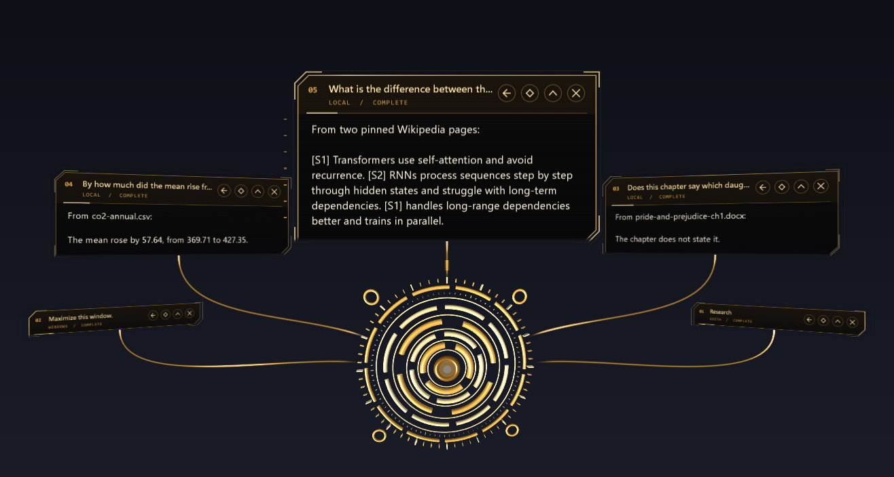

# E D I T H

### Your work stays on your desktop. Your assistant should know which work you mean.

[Request a demonstration](mailto:skilaru@arizona.edu?subject=EDITH%20demonstration) · [Private implementation](https://github.com/hemu77/edith-windows-assistant)

Windows-native interaction · Local-first inference · Source-aware answers · Governed tools

## At a glance

EDITH is a Windows desktop assistant prototype built around a small local model (Qwen3-4B). It is also the test bed for a research study on one question: when an assistant reports what happened on the desktop, how do you make sure it is reporting the right revision and the right attempt?

Headline results from the study (private working draft, 8 November 2026, not peer reviewed):

| Finding | Result |
|---|---|
| Host verification of process exits, fresh retry and missing-record questions | EDITH 32/32, stock Qwen 24/32 |
| Windows matched study, 30 exit questions | Stock 16, host-only 24, host + Qwen 24 |
| Public code-review records | Stock 14/28, exact commit comparison 28/28 |
| LoRA adaptation, exact responses before export | 84 to 108 of 144, but it rejected all 3 valid approvals that stock accepted. Not deployed. |
| Passage selection, blinded pilot | BM25 surfaced the needed evidence 128/128, yet all eight arms solved 0/32 whole bundles |
| Requiring valid JSON | Malformed output 20 to 0, invented numbers 2/16 to 16/16 |
| Physical Dell laptop, spoken status requests | 3 of 3 reported correctly; no duplicate launches |

The short version: fixing the problem in host software that observes the action worked. Fixing it in model weights or by supplying better passages did not. Details, negative results and limits are in the [research section](#research-when-should-a-desktop-assistant-look-again-evidence-binding-in-qwen3-4b) below.

EDITH is a working prototype. It is not released, not production certified, and the study materials are private.

## The idea

EDITH explores a practical question: can a small local model become a useful desktop assistant when its surrounding software supplies the right evidence, clear permissions and reliable tools?

Rather than treating the desktop as one giant prompt, EDITH tracks the owner's selected source, distinguishes captured facts from missing information, and separates answering from acting. Voice and typed requests share a runtime. A transparent golden HUD keeps answers near the work.

The goal is accessible, private assistance with reading, comparing, remembering and bounded desktop tasks. It is a working prototype, not AGI, a universal computer operator, or a guarantee of error-free answers.

## The golden HUD

Existing project visual of the native golden reactor and layered-answer design. This is not a new recording of the October 23 tests, proof of speech accuracy, or a promise that every displayed interaction works on every device. The private repository contains implementation details and the verification record.

## Research: When should a desktop assistant look again? Evidence binding in Qwen3-4B

**Status:** private working draft manuscript, dated 8 November 2026. It has not been peer reviewed. The manuscript, data and code are private; the numbers below are reported from that draft.

### The question

A desktop assistant can be wrong while quoting something real. It can read a genuine number from the wrong revision of a document, or a genuine success record from the wrong attempt at a task. The study asked where this should be fixed:

1. in the **model weights**,
2. in the **evidence supplied** to the model, or
3. in **host software that observes the action**, which the draft calls *evidence binding*.

### Results

| Approach | What was tested | Result |
|---|---|---|
| Model adaptation | LoRA rank 8 on query/value across all 36 blocks (2,949,120 parameters, 355.2 s training) on a CyVerse NVIDIA A16 | Exact responses rose from 84 to 108 of 144 before export, but the adapter rejected all 3 valid approvals that stock accepted. Matched 4-bit exports scored 89 versus 98 of 144 (stock versus adapted), with 7 previously correct freshness decisions lost. **Not deployed.** |
| Direct weight edits and block removal | Block-24 query-normalization edits; removing individual blocks | No replacement model. Removing block 31 saved 2.56% but chose a superseded value, 1,262 over 3,711, on long documents. |
| Passage selection | Blinded pilot, 1,024 arm-question predictions, eight arms including oracle passages | BM25 surfaced all needed evidence 128/128, yet every arm solved 0/32 whole bundles. Retrieval recall was not the bottleneck. |
| Showing source identities | Frozen identity holdout, 288 predictions, independently AI-authored | Fully supported answers rose from 1/96 to 5/96 (paired scenario-bootstrap 95% CI 0.00 to 9.38 points). False YES stayed at 23/36. |
| Exact commit comparison | Public code-review records | Stock 14/28, exact commit comparison 28/28. |
| Requiring valid JSON | Structured-output constraint | Malformed output fell from 20 to 0, but invented numbers rose from 2/16 to 16/16. |
| Summarizer repair | Targeted repair of the summarizer | 9/9 answerable targets recovered, 14/14 missing or conflicting targets withheld, 14 prior outputs unchanged. |
| Host verification of process exits | EDITH checks the exact session and invocation before Qwen phrases the result | 32/32 versus 24/32 for stock on fresh retry and missing-record questions (original frozen set: 16/16 versus 11/16). All stock errors were unnecessary abstentions. |
| Windows matched study | 30 exit questions | Stock 16, host-only 24, host + Qwen 24. Preserving contradictory receipts raised correct abstentions from 12/18 to 18/18. |
| Natural documents | OpenSSH, SQLite and GitHub material | Prior rule 8/32, conservative extractor 23/32, few-shot Qwen 20 to 22 of 32. Excluding obsolete sources repaired all six selected failures (post-hoc). |

### What the host layer does, and what it costs

- **Latency.** Median warm service time was about 0.65 s for known exits and under 1 ms for missing records. In the Windows study, fixed host wording took 0.962 ms, against 1.313 s when Qwen worded the answer.
- **A host bug found and fixed.** An earlier host rule flattened disagreeing ledgers into one answer and falsely confirmed 3 requests. Keeping each ledger's finding distinct repaired it (45/48 to 48/48).
- **Physical test.** On a physical Dell laptop, the owner asked for status three times through the built-in microphone. EDITH correctly reported a failure (exit 7), an approved retry that succeeded (exit 0), and no receipt in a new session. The launch journal stayed at two entries and duplicates were rejected.

### Negative results worth reporting

- The LoRA adapter looked better on exact-match scoring and worse on the behaviour that matters: it refused valid approvals and lost correct freshness decisions after quantization.
- Perfect retrieval did not help. With the needed evidence present in every case, including oracle passages, no arm solved a whole bundle.
- Forcing valid JSON removed malformed output and made the content worse: every one of the 16 checked outputs then contained an invented number.
- Showing verified source identities helped only slightly, and the confidence interval includes zero.

### Conclusion

Let the host establish what happened, let the model explain it, and allow neither a missing record nor an old success to become permission to act again.

### Scope and limits

- This is a retrospective series of experiments, not a single pre-registered study.
- Most fixtures are synthetic. The identity holdout was AI-authored, not human-authored.
- The natural-document repair was post-hoc on six selected failures.
- None of this is an official OSWorld score.
- The physical test is one laptop, one owner, three requests.
- Materials are private and no second lab has reproduced the results.
- The adapted and edited models were not deployed. EDITH still runs the original Qwen3-4B.

### Next steps

- OSWorld-style write actions.
- An independent, human-authored holdout.
- Reproduction by a second lab.

## Why this project is interesting

| Design choice | Why it matters |
|---|---|
| A source desk, not a pile of screenshots | Captures retain source identity and versions. Ambiguous or sensitive sources need deliberate handling. |
| Local reasoning with typed host controls | A plausible model instruction is not execution permission. Tools have contracts, approvals and recorded results. |
| Evidence-aware completion | A displayed answer, accepted request and completed action are different states. Tests check terminal evidence, not reassuring words. |
| Personal and Research boundaries | Explicitly saved facts and temporary source history have different lifetimes. Missing memory must not become invented recollection. |
| Native layered interaction | The golden OpenGL reactor and message panes coexist with ordinary Windows applications; typed input complements voice. |

These are integrated engineering priorities, not claims that no other project has similar features.

## Current implementation scope

- Hotkey activation, native HUD, typed interaction and a local voice pipeline.
- Windows readings and registered controls, with consequential actions gated.
- Text, Word, PDF and CSV analysis; bounded browser/window capture when accessible.
- Source labels, extraction coverage, pinned-source comparison and temporary session recall.
- A governed MCP host with bounded transport, tool-definition checks, one-use approval decisions and action receipts.
- Explicit local Personal memory with searchable owner statements and exact-ID deletion. No automatic learning of private documents into model weights.
- Owner-managed task lists, pinned-source task references and local handoff notes. Marking a task done is not autonomous execution; recorded tool effects remain separate.
- Bounded scanned-PDF OCR and conservative image-supported spacing repair. Unreadable pages and uncertain text remain explicitly partial.
- Original local Qwen inference retained. Codex routing is disabled in the shared local-only installation.

Offline use requires installing model and speech assets first. Optional network tools have their own disclosure boundaries. EDITH does not read every tab, understand every application, or certify a whole book's factual summary.

## Recent engineering work

October 25 adds practical coordination around reading: turn a source discussion into explicit tasks, revisit them in Personal mode, and export a local handoff without sending anything. Named environment-variable diagnostics show only configured/empty/missing, not credential values or remote validity.

These are development changes in [private PR #1](https://github.com/hemu77/edith-windows-assistant/pull/1), not a claim of a merged or production-certified release.

Evaluation included 22 format-stratified local files, public-paper OCR experiments and real local-model summary runs. Review uncovered and repaired provenance, session-isolation and recognition-entry-point bugs. Aggressive OCR spacing and full-context packing candidates were rejected when they worsened results. Large first summaries can still take minutes; OCR and generated facts still require source checking. Private documents and transcripts are not published here.

The October 23 recovery addresses bugs that can masquerade as weak model intelligence: explicit file questions that never capture the file; cleared Research sessions falling back to invented recall; HUD completion before the next turn can be accepted; and approvals becoming stale while tools wait.

The private handoff separates reproduced failures, regression tests, live typed checks and pending physical tests. Synthetic fixtures and real local documents are used without publishing private desktop logs. The research numbers on this page come from the private draft manuscript; the pinned evidence record behind them stays in the private repository, and no readiness claim is made here.

## Technology

| Layer | Stack and role |
|---|---|
| Desktop runtime | Python, Win32/ctypes, Windows UI Automation and local IPC |
| Native presentation | OpenGL/moderngl, software fallback, transparent layered windows and interactive panes |
| Control center | React, TypeScript and Vite; separate from the native golden HUD |
| Local inference | Quantized GGUF through llama.cpp; original Qwen3-4B deployment retained |
| Speech | Local capture/VAD, Faster Whisper recognition, owner verification and Windows speech playback |
| Documents | Local parsers, structured table calculations and bounded source extraction |
| Memory and audit | SQLite, source/version metadata, approved-fact retrieval and action receipts |
| Tools | MCP/JSON-RPC, pinned definitions, scoped approvals and bounded process lifetime |
| Verification | Pytest, Ruff, frontend tests/build and live listener-IPC scenarios |

Windows is the primary desktop target. macOS installation/gateway work does not establish equivalent native HUD, microphone or application-control support. Fresh-machine rendering and hardware compatibility still need installation testing. Report failures with OS, device, steps, expected result and a redacted error log.

## Other research directions

The adapter experiments once proposed here have now been run and are reported above; they did not produce a model worth deploying. Comparing other small local models through the same fixed, corrected host, and separating text/UI Automation tool use, visual grounding and speech accuracy, remains proposed work.

Memory research compares lightweight retrieval with graph/vector systems such as Cognee. Relevance, provenance, deletion, latency and memory use must justify added components. Researching a model or memory platform does not mean it is deployed.

## For collaborators and recruiters

The implementation and the manuscript are private. A public link alone does not grant access. Contact the owner for a demonstration or suitable repository access; private source, recordings, credentials and model files are not included here.

### CONTACT **skilaru@arizona.edu** TO VIEW THE IMPLEMENTATION

## Attribution

EDITH began as a fork of and reference to Apache-2.0 OpenJarvis. Its desktop-focused runtime, interaction and governance goals developed separately. It is not the official OpenJarvis product; applicable upstream license and attribution notices remain preserved.

---

Physical voice, fresh-device rendering, long-duration reliability and arbitrary application behavior require further validation. Model answers can still be wrong; approvals and source evidence reduce risk, not eliminate it.
